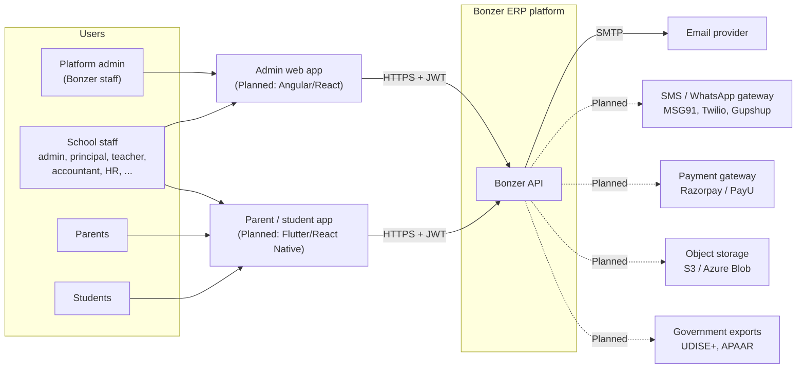
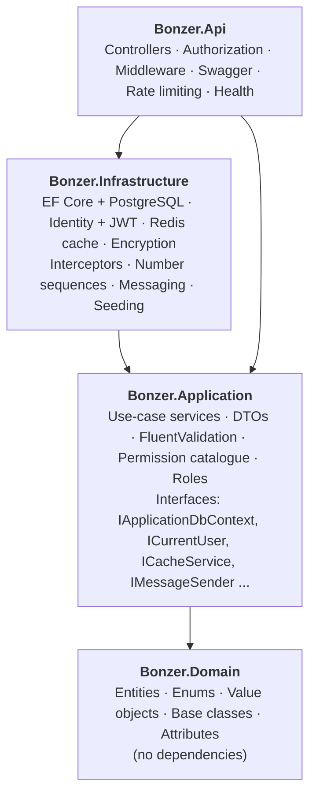
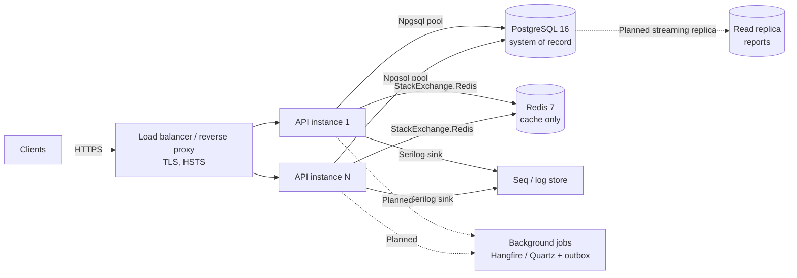
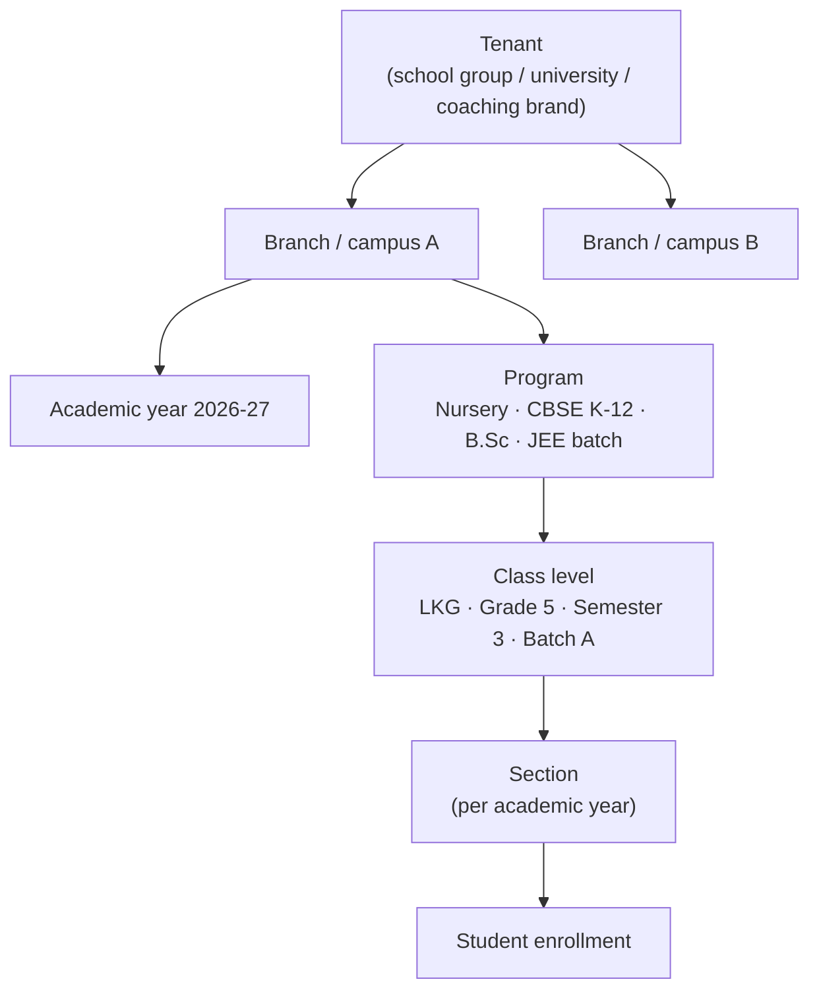
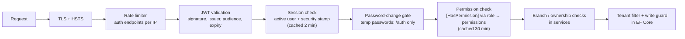
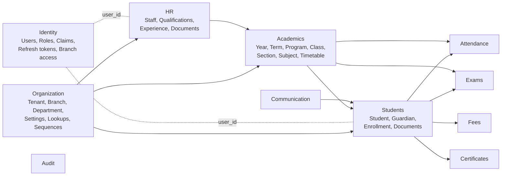
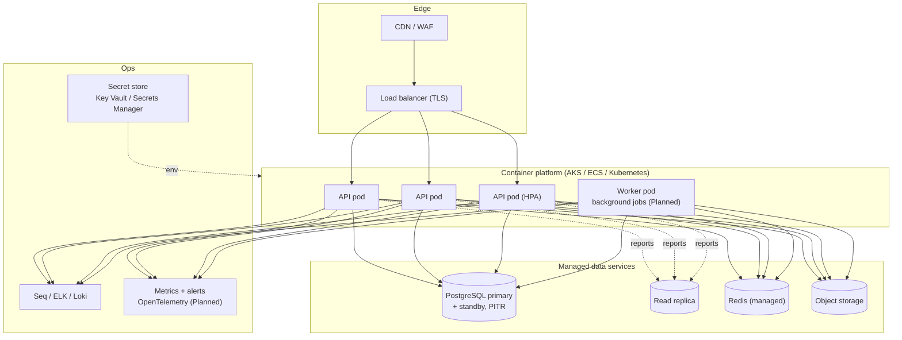

# Bonzer ERP: High-Level Design (HLD)

| | |
|---|---|
| Status | Living document, versioned with the code |
| Scope | Whole platform: what exists today (marked **Built**) and the target architecture (marked **Planned**) |
| Companion docs | [LLD.md](LLD.md) (classes, tables, sequences, algorithms) · [DB-REVIEW.md](DB-REVIEW.md) · [ROADMAP.md](ROADMAP.md) |

---

## 1. Purpose and scope

Bonzer ERP is a multi-tenant SaaS for educational institutions of any level: pre-primary, K-12 schools,
junior colleges, universities and tuition / coaching centres. One deployment serves many customers
(tenants); each customer can run many campuses (branches).

The HLD answers *what the major parts are, how they talk, where they run, and why they were chosen*.
How each part is built internally is in the [LLD](LLD.md).

### 1.1 Goals

| # | Goal | How the design meets it |
|---|---|---|
| G1 | One product for every education level | Generic academic model: Program → ClassLevel → Section, configurable grading (marks, grades, CGPA) |
| G2 | Many customers on one platform, fully isolated | Shared database, `tenant_id` on every row, global query filters + write guard |
| G3 | Multi-campus groups | Branch-scoped data, per-user branch access, tenant-wide roles for group management |
| G4 | Schools configure, not developers | Custom roles from a permission catalogue, lookups, settings, jsonb custom fields, number formats |
| G5 | Trustworthy with children's data | Encryption of national IDs, full audit trail, least-privilege permissions, DPDP Act readiness |
| G6 | Cheap to operate, easy to scale | Stateless API, PostgreSQL + Redis only, containerised |

### 1.2 Non-functional requirements

| Quality | Target | Mechanism |
|---|---|---|
| Availability | 99.9 % monthly per region | ≥ 2 API instances behind a load balancer, managed PostgreSQL with failover, health probes |
| Latency | p95 < 300 ms for reads, < 800 ms for writes | Indexed queries, projection DTOs, Redis caching of permissions / sessions / master data |
| Scale (per region) | 2,000 tenants, 2 M students, 500 req/s peak (attendance at 9 AM, results day) | Horizontal API scale, connection pooling, partitioning of high-volume tables (Planned) |
| Security | OWASP ASVS L2 | JWT + rotating refresh tokens, lockout, rate limits, permission checks on every endpoint, encryption at rest |
| Data isolation | Zero cross-tenant reads or writes | Filters on reads, interceptor guard on writes, tests |
| Auditability | Every business change and security event recorded | Audit interceptor + security auditor into `audit_logs` |
| Recoverability | RPO ≤ 5 min, RTO ≤ 1 h | PITR backups of PostgreSQL; Redis is a cache only (no data loss if it is wiped) |
| Maintainability | New module in days, not weeks | Clean Architecture, conventions applied model-wide, one folder per feature |
| Observability | Any request traceable by tenant / user / correlation id | Serilog structured logs → Seq; OpenTelemetry (Planned) |

### 1.3 Constraints

* .NET 8 LTS (support ends 10 Nov 2026 → upgrade to .NET 10 LTS is planned, one-line change).
* PostgreSQL is the only system of record. Redis may be lost at any time without data loss.
* Indian market first: Aadhaar, PAN, UAN, IFSC, UDISE+, RTE, DPDP Act 2023; but nothing hard-codes India.

---

## 2. System context

---

## 3. Architecture overview

### 3.1 Architectural style

**Modular monolith with Clean Architecture.** One deployable API, internally split into
business modules (Students, Staff, Fees, ...) that share one database but own their own tables and
services.

Why not microservices now: a school ERP is highly relational (a fee invoice references student,
enrollment, class, academic year, concession). A monolith gives ACID transactions across modules,
one deployment, and low running cost per tenant. Module boundaries (one folder per feature, one
configuration folder per module, no cross-module service calls except through interfaces) keep
the option to extract a service later (likely candidates: Notifications, Reporting, Payments).

### 3.2 Logical layers

Dependencies only point inward. The Application layer defines interfaces; Infrastructure implements
them (Dependency Inversion). The Domain has no framework references.

### 3.3 Container view (runtime)

The API is **stateless**: no session affinity, no in-memory state that matters. Everything shared
lives in PostgreSQL (including Data Protection keys used by password-reset links) or Redis (caches).

---

## 4. Functional decomposition (modules)

| Module | Responsibility | Status |
|---|---|---|
| **Platform & tenancy** | Tenants, subscription plan, branches, departments, settings, lookups, number sequences | Model **Built**, Departments API **Built** |
| **Identity & access** | Login (username/email/phone), refresh rotation, logout / logout-all, sessions, forgot/reset password (email link or SMS code), forced password change, user admin, roles & permissions, branch access | **Built** |
| **Academics** | Academic years, terms, programs, class levels, sections, subjects, class-subject mapping, teacher assignments, timetable, holidays | Model **Built**, Academic-year API **Built** |
| **Students & admissions** | Student profile, guardians (one login for all siblings), enrollment per year, subjects, previous education, documents, auto admission no. | **Built** |
| **Human resources** | Staff master (all employee types), qualifications, experience, documents, bank & statutory details, staff login + roles, status lifecycle | **Built** |
| **Attendance** | Daily / period attendance, locks, leave requests, corrections, staff attendance | Model **Built** |
| **Examinations** | Exam types, components, grading schemes, marks, results, hall tickets | Model **Built** |
| **Fees** | Fee heads, structures, installments, concessions, invoices, payments, allocations | Model **Built** |
| **Communication** | Notifications with recipients, homework and submissions | Model **Built** |
| **Certificates** | Templates, issued certificates (TC, bonafide, character) | Model **Built** |
| **Parent / student portal** | My children, (attendance, fees, results: Planned) | Children API **Built** |
| **Audit** | Data-change trail and security events | **Built** |
| Payroll, transport, library, hostel, inventory, LMS, analytics | Enterprise modules (permissions already in the catalogue) | Planned |

### 4.1 Organisational hierarchy

This one hierarchy covers every segment: a nursery is Program "Pre-primary" → levels Playgroup/LKG/UKG;
a university is Program "B.Tech CSE" → Semesters 1..8; a coaching centre is Program "JEE 2027" → batches.

---

## 5. Multi-tenancy design

| Decision | Choice | Alternatives considered |
|---|---|---|
| Isolation model | **Shared database, shared schema, `tenant_id` column** | DB-per-tenant (costly ops, migrations × N); schema-per-tenant (catalogue bloat at 1000s of tenants) |
| Read isolation | EF Core global query filter on every `TenantEntity`, built automatically | Manual `Where` in every query (easy to forget) |
| Write isolation | `AuditableEntityInterceptor` stamps `tenant_id` on insert and throws on cross-tenant write | DB row-level security (planned as defence in depth) |
| Tenant resolution | `tenant_id` claim inside the signed JWT | Sub-domain / header (spoofable without extra checks) |
| Platform access | SuperAdmin (no tenant) bypasses filters explicitly | — |
| Uniqueness | Unique indexes include `tenant_id` (and `branch_id`) and ignore soft-deleted rows | — |

Branch scoping is a second level: branch-owned rows carry `branch_id`; non-tenant-wide users only see
branches listed in their `user_branch_access` (carried as `branch_id` claims) and services call
`EnsureBranchAccess`.

Planned hardening: PostgreSQL Row-Level Security policies keyed on `app.tenant_id` set per connection,
so even raw SQL cannot cross tenants; per-tenant rate limits and feature flags by `Tenant.Plan`.

---

## 6. Security architecture

| Concern | Design |
|---|---|
| Authentication | ASP.NET Core Identity (PBKDF2 hashes), lockout 5 attempts / 15 min, login by username / email / phone |
| Tokens | Access JWT 15 min (HS256), refresh 7 days, **rotated on every use**, stored as SHA-256 hash, reuse ⇒ all sessions revoked |
| Instant revocation | Security-stamp hash claim compared on every request: password change/reset, role change, deactivation, logout-all apply on the next call |
| Authorization | RBAC over **fine-grained permissions** (~80). Roles are permission bundles; 25 built-in roles; tenants define custom roles. Privilege-escalation guard: you can only grant what you hold; SuperAdmin / TenantAdmin / Director reserved |
| Password recovery | Email link (Data Protection token, 30 min, single use) or 6-digit SMS TOTP (3 min); same 202 response for unknown accounts; wrong codes count towards lockout |
| Data protection | AES-256-GCM column encryption for Aadhaar / national IDs / bank account numbers; masked in API responses and audit logs |
| Secrets | Never in source; environment / secret store; app refuses to start without JWT and encryption keys |
| Audit | Every change (old/new values) and every security event (login, failure, reset, role change, token reuse) |
| Transport / headers | HTTPS redirect, HSTS, CORS allow-list |

---

## 7. Data architecture

* **Store**: PostgreSQL 16, one database, ~70 tables, snake_case naming, EF Core code-first migrations.
* **Keys**: UUID v7 (time-ordered, generated in the app). Index-friendly like a sequence, safe to expose,
  known before insert.
* **Lifecycle**: soft delete everywhere for business data; no cascade deletes.
* **Concurrency**: optimistic, using PostgreSQL `xmin` on contended rows (Student, Staff, Mark, Invoice, Payment) → HTTP 409.
* **Flexibility**: `custom_fields jsonb` on Student and Staff; lookups table for school-defined lists.
* **Numbers**: admission, receipt, invoice, TC, employee codes from `document_sequences` with per-branch
  format (`{PREFIX}/{YEAR}/{SEQ}`), atomic and gap-free within a transaction.
* **Audit**: `audit_logs` written in the same transaction as the change.
* **Volume planning**: `student_attendance` (≈ 200 rows per student per year) and `audit_logs` are the
  largest tables → monthly partitioning and archival are planned.

Domain overview (details and full ER diagrams in the [LLD §5](LLD.md#5-data-model)):

---

## 8. Caching strategy

| Data | Key | TTL | Invalidation |
|---|---|---|---|
| Role → permissions | `perm:{tenant}:{ROLE}` | 30 min | On role create/update/delete and at seeding |
| Session state (active + stamp hash) | `user-session:{userId}` | 2 min | On any account change (roles, status, password, logout-all) |
| Academic years per branch | `academic-years:{branchId}` | 30 min | On create / update / set-current |
| Lookups | `lookups:{tenant}:{category}` | 30 min | On change |

Cache-aside pattern through `ICacheService`. Redis failures **never fail a request**: a circuit
breaker skips the cache for 30 s and requests go to the database. Without a Redis connection string
the app uses an in-memory cache (single instance / development only).

---

## 9. Integration architecture

| Integration | Pattern | Status |
|---|---|---|
| Email | `IMessageSender` → SMTP | **Built** (logs when SMTP not configured) |
| SMS / WhatsApp | `IMessageSender` → provider adapter | Interface **Built**, provider Planned |
| Payment gateway | Create order → client checkout → **webhook** (idempotent on gateway payment id, unique index exists) | Planned |
| File storage | Upload to object storage, store URL only | Planned (URLs already modelled) |
| Notifications at scale | **Transactional outbox** table + background dispatcher with retries | Planned |
| Exports (UDISE+, Tally, Excel) | Background job → file → download link | Planned |
| Public API / webhooks for partners | API keys per tenant + signed webhooks | Planned |

---

## 10. Deployment architecture

### 10.1 Development (Built)

`docker compose up -d --build` runs the API (port 8080), PostgreSQL 16 (host port 5433), Redis 7 and
Seq (UI port 8081). In Development the API applies migrations and seeds roles, a super admin and a
demo school at startup.

### 10.2 Production (target)

* Migrations run as a **separate release step** (`Database:MigrateOnStartup=false` in production).
* Liveness `/health/live` (process up) and readiness `/health/ready` (PostgreSQL + Redis reachable).
* Container runs as a non-root user; image built by a multi-stage Dockerfile.
* Data residency: Indian tenants in an Indian region (DPDP Act).

### 10.3 Scalability path

1. Scale API pods horizontally (stateless).
2. Add PgBouncer for connection pooling as pods grow.
3. Move reports and dashboards to the read replica.
4. Partition `student_attendance` and `audit_logs` by month.
5. Background workers for bulk jobs (invoices for 5,000 students, report cards, notifications).
6. Shard very large tenants onto their own database cluster (tenant → connection-string map). The
   tenant column design makes this a routing change, not a schema change.

---

## 11. Observability

| Signal | Tool | Detail |
|---|---|---|
| Logs | Serilog → console, async rolling JSON files (30 days), Seq | Every log line carries `TenantId`, `UserId`, `CorrelationId`, version, machine, environment; structured exception details |
| Errors | `ExceptionMapper` + ProblemDetails | Stable error `code` per failure, correlation id in every response, no internals in production |
| Performance | Slow request (> 2 s) and slow SQL (> 500 ms) warnings | Thresholds configurable |
| Request logs | `UseSerilogRequestLogging` | Method, path, status, duration, client IP, user agent |
| Health | ASP.NET health checks | Liveness and readiness |
| Audit | `audit_logs` table | Business changes and security events, queryable per tenant |
| Traces / metrics | OpenTelemetry → Grafana / Azure Monitor | Planned |

---

## 12. Availability and disaster recovery

| Failure | Behaviour |
|---|---|
| One API instance dies | Load balancer routes around it; no session loss (stateless JWT) |
| Redis down | Circuit breaker → requests served from PostgreSQL, slightly slower; no errors |
| PostgreSQL primary down | Managed failover to standby (target RTO minutes); API reconnects |
| Bad deployment | Roll back the container image; migrations are additive and backward compatible |
| Data corruption / accidental delete | Soft delete for business data + PITR restore (RPO ≤ 5 min) |
| Region outage | Restore from geo-redundant backups in a paired region (RTO ≤ 4 h) |

---

## 13. Key architecture decisions (ADR summary)

| # | Decision | Rationale | Consequence |
|---|---|---|---|
| ADR-01 | Modular monolith, Clean Architecture | Relational domain, small team, low cost | Must police module boundaries in reviews |
| ADR-02 | PostgreSQL over MySQL / SQL Server | jsonb, partial unique indexes, `xmin`, partitioning, open source | Npgsql-specific features used (accepted) |
| ADR-03 | Shared-schema multi-tenancy | Cheapest at thousands of small schools | Isolation depends on filters → tested and planned RLS |
| ADR-04 | UUID v7 keys | Ordered inserts, globally unique, no DB round trip | 16-byte keys |
| ADR-05 | Permissions, not role checks, in code | Schools invent their own roles | Permission catalogue must be maintained |
| ADR-06 | Short JWT + rotating refresh + stamp check | Stateless scale with instant revocation | One cached lookup per request |
| ADR-07 | Soft delete + audit interceptors | Legal / compliance need for history | Filters everywhere; unique indexes are partial |
| ADR-08 | Redis as optional cache, never a store | Simpler ops, survivable outages | No distributed locks in Redis; use PostgreSQL |
| ADR-09 | Serilog + Seq | Structured logs, cheap, self-hosted | Move to OpenTelemetry for traces later |
| ADR-10 | Services over EF Core directly (no repository layer) | EF DbContext already is unit-of-work + repository; less boilerplate | Application depends on EF abstractions |
| ADR-11 | Column encryption in the app (AES-GCM) | Works on any managed PostgreSQL, key outside the DB | Encrypted columns are not searchable |

---

## 14. Risks and mitigations

| Risk | Mitigation |
|---|---|
| A query bypasses tenant filters (`IgnoreQueryFilters`, raw SQL) | Code review rule, unit tests on filters, planned RLS |
| Encryption key lost | Key in a managed vault with backup; rotation procedure documented before go-live |
| .NET 8 end of support (Nov 2026) | Upgrade to .NET 10 LTS (one property in `Directory.Build.props`) |
| Peak load at fixed times (attendance 9 AM, results day) | Autoscale, caching of master data, read replica for results |
| SMS / payment provider outages | Outbox + retries (Planned), provider abstraction for switching |
