# Bonzer ERP: Low-Level Design (LLD)

| | |
|---|---|
| Status | Living document. Sections marked **Planned** describe the agreed design of modules not yet coded |
| Read first | [HLD.md](HLD.md) |
| Source of truth | The code. If this document and the code disagree, fix whichever is wrong in the same PR |

Contents

1. [Code organisation](#1-code-organisation)
2. [Dependency injection and startup](#2-dependency-injection-and-startup)
3. [Request pipeline](#3-request-pipeline)
4. [Domain model foundations](#4-domain-model-foundations)
5. [Data model](#5-data-model)
6. [Persistence internals](#6-persistence-internals)
7. [Identity and authentication](#7-identity-and-authentication)
8. [Authorization](#8-authorization)
9. [Application services](#9-application-services)
10. [Document numbering](#10-document-numbering)
11. [Caching](#11-caching)
12. [Errors, validation and API conventions](#12-errors-validation-and-api-conventions)
13. [Logging and auditing](#13-logging-and-auditing)
14. [Configuration reference](#14-configuration-reference)
15. [Design patterns used](#15-design-patterns-used)
16. [Planned module designs](#16-planned-module-designs)
17. [Testing strategy](#17-testing-strategy)
18. [How to add a module](#18-how-to-add-a-module)

---

## 1. Code organisation

```
src/
  Bonzer.Domain/            Entities, enums, value objects. References nothing.
    Common/                 BaseEntity → AuditableEntity → TenantEntity → BranchEntity, contracts,
                            UuidV7, Address, [Encrypted], [AuditIgnore]
    Enums/                  One file per module; stored as strings
    Entities/<Module>/      Organization, Academics, Students, HumanResources, Attendance,
                            Exams, Fees, Communication, Certificates, Audit
  Bonzer.Application/       Use cases. References Domain + EF Core abstractions + FluentValidation.
    Common/Interfaces/      IApplicationDbContext, ICurrentUser, ICacheService, IDocumentNumberGenerator,
                            IPermissionService, IUserAccountService, IMessageSender
    Common/Exceptions/      NotFound, Conflict, BusinessRule, Forbidden, Unauthorized
    Common/Models/          PagedQuery, PagedResult
    Common/Caching/         CacheKeys
    Security/               Permissions (catalogue), AppRoles (built-in roles + defaults), AppClaimTypes
    Features/<Feature>/     <Feature>Contracts.cs (DTOs + validators + service interface) and <Feature>Service.cs
  Bonzer.Infrastructure/    Implementations. References Application.
    Identity/               Users, roles, tokens, auth, permissions, sessions, security audit
    Persistence/            BonzerDbContext, Configurations/<Module>, Conventions, Interceptors,
                            Encryption, Migrations, Seed
    Caching/                DistributedCacheService (circuit breaker)
    Services/               DocumentNumberGenerator, MessageSender
  Bonzer.Api/               Host. References Application + Infrastructure.
    Controllers/            Thin: bind → call service → map result to HTTP
    Authorization/          [HasPermission], dynamic policy provider, handler
    Middleware/             GlobalExceptionHandler, LogEnrichment, PasswordChangeRequired
    Extensions/             AddApi (controllers, auth policies, rate limits, CORS, health, Swagger)
tests/
  Bonzer.UnitTests/         Model, tenant filter, security, validators
```

Rules

| Rule | Reason |
|---|---|
| Domain has no `using Microsoft.*` | Business model stays framework-free |
| Application never references Infrastructure | Dependency inversion; infrastructure is swappable |
| Identity types (`ApplicationUser`) stay in Infrastructure | Domain links to users only by `UserId` |
| Controllers contain no business logic | Services are testable without HTTP |
| One feature folder per module; a service only writes its own module's tables | Keeps the monolith splittable |

---

## 2. Dependency injection and startup

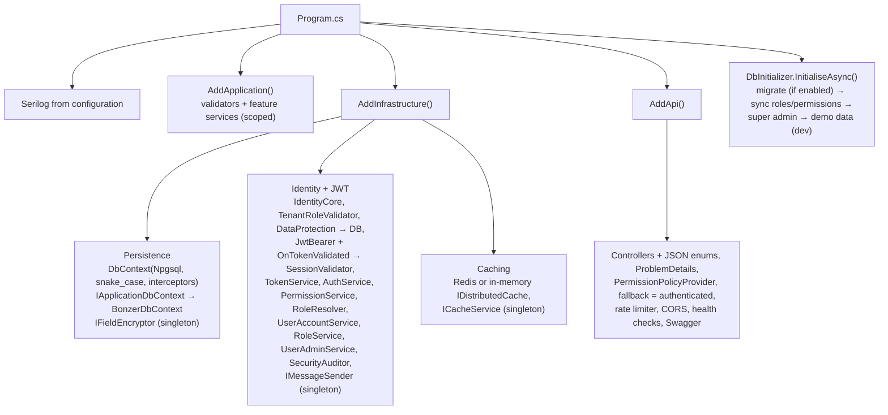

Lifetimes: everything touching the DbContext is **scoped** (one per request). `ICacheService`,
`IFieldEncryptor`, `IMessageSender` and `TimeProvider` are singletons and hold no per-request state.

Startup fails fast (`ValidateOnStart`) if `Jwt:SigningKey` (≥ 32 chars) or `Encryption:Key`
(32 bytes, base64) is missing.

---

## 3. Request pipeline

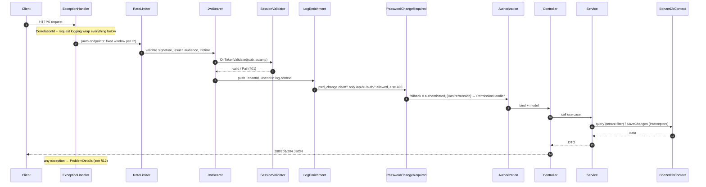

---

## 4. Domain model foundations

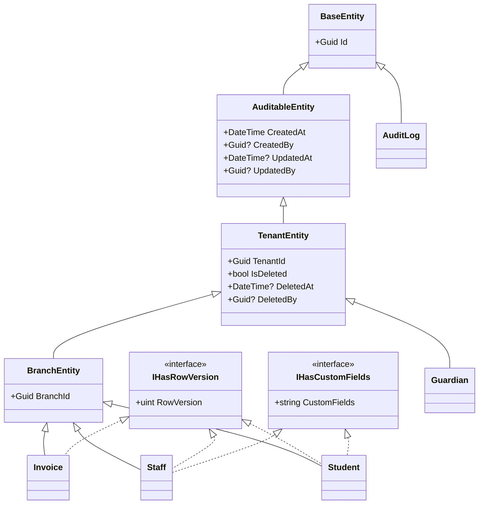

Choosing a base class

| Base | Use when | Gets automatically |
|---|---|---|
| `BaseEntity` | Append-only system rows (AuditLog) | UUID v7 key |
| `AuditableEntity` | Platform rows without tenant (Tenant) | + created/updated stamps |
| `TenantEntity` | Shared across campuses (Guardian, LookupValue, child rows) | + tenant FK, tenant filter, soft delete |
| `BranchEntity` | Belongs to one campus (Student, Staff, Section, Invoice) | + branch FK |

Value objects (EF owned types, same table): `Address`, `MedicalInfo`, `GovernmentSchemeInfo`,
`BankDetails`, `StatutoryDetails`. They are updated **in place** (never replaced) so the audit trail
shows only changed fields.

Attributes: `[Encrypted]` → AES-GCM at rest + masked in audit and DTOs; `[AuditIgnore]` → excluded
from the audit trail.

---

## 5. Data model

69 tables. Naming: snake_case, plural table names, `ix_`/`ux_` index names. All business unique
indexes are **partial** (`WHERE is_deleted = false`) so a soft-deleted row never blocks re-use.

### 5.1 Organization and identity

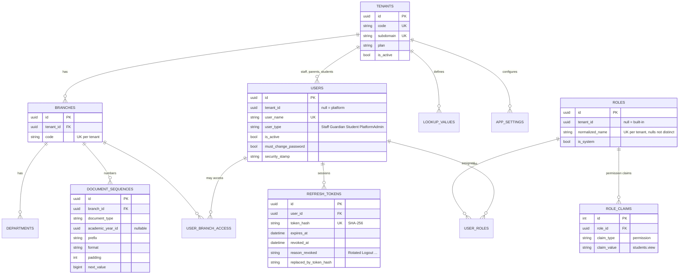

### 5.2 Academics and students

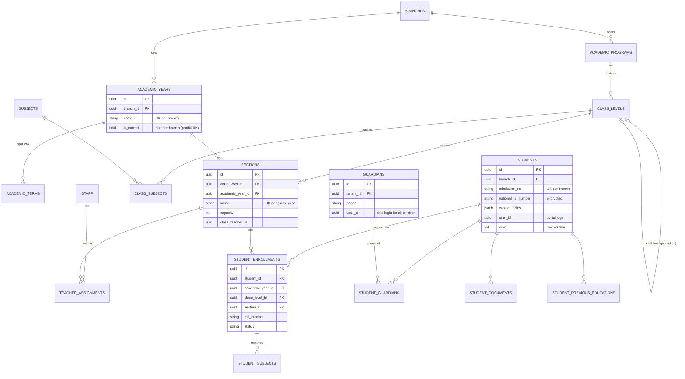

### 5.3 Human resources

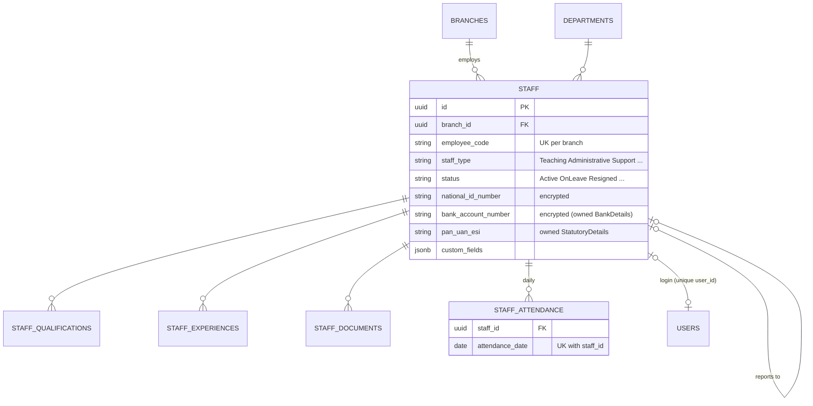

### 5.4 Attendance, exams, fees

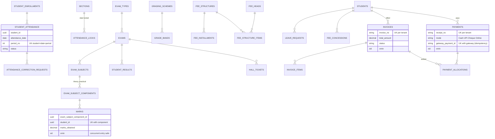

Communication (`notifications`, `notification_recipients` UK notification+user+channel, `homework`,
`homework_submissions` UK homework+student), certificates (`certificate_templates`,
`issued_certificates` UK tenant+type+number) and `audit_logs` complete the model. The full mapping
from the original schema is in [DB-REVIEW.md](DB-REVIEW.md).

---

## 6. Persistence internals

### 6.1 Model conventions (`ModelBuilderExtensions.ApplyErpConventions`)

Applied to every entity after the per-entity configurations, in this order:

| # | Convention | Effect |
|---|---|---|
| 1 | UUID v7 key generator | `Id` generated client-side, time ordered |
| 2 | Tenant / branch FKs | `tenant_id → tenants`, `branch_id → branches` added if not configured |
| 3 | Row version | `IHasRowVersion.RowVersion` → `xmin` concurrency token |
| 4 | Custom fields | `IHasCustomFields.CustomFields` → `jsonb` |
| 5 | Global query filter | `e => !e.IsDeleted && (ctx.BypassTenantFilter \|\| e.TenantId == ctx.CurrentTenantId)` |
| 6 | Encryption | every `[Encrypted]` property (also inside owned types) gets `EncryptedStringConverter` |
| 7 | No cascade | every non-ownership cascade FK → `Restrict` |
| 8 | Owned types required | owned value objects always materialised |

Plus in `ConfigureConventions`: enums as strings, `decimal` → `numeric(18,2)`, strings default max length.

The filter references the **DbContext instance** (`Expression.Constant(context)`), so EF re-evaluates
`CurrentTenantId` per query instead of caching the tenant of the first request.
`BypassTenantFilter = currentUser.IsSystem || currentUser.IsPlatformAdmin`.

### 6.2 Save pipeline (interceptors)

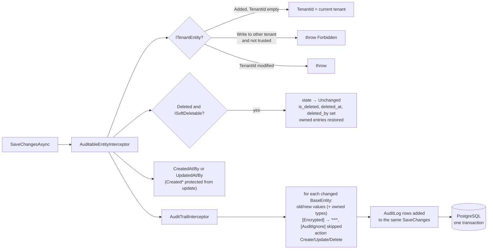

Order matters: stamps and soft deletes first, so the audit trail records the soft delete as `Delete`.

### 6.3 Column encryption

`AesGcmFieldEncryptor`: AES-256-GCM, random 12-byte nonce per value, stored as
`v1:` + `base64(nonce ‖ tag ‖ ciphertext)`; the version prefix allows key rotation, and values without it are
read as legacy plain text. The key comes from
`Encryption:Key`. Consequences: encrypted columns cannot be searched or indexed; duplicates (e.g.
Aadhaar uniqueness) need a separate keyed hash column (Planned: `national_id_hash` HMAC-SHA256).
DTOs return masked values unless the caller may see them (`Masking.Mask`, e.g. `XXXXXXXX1234`).

### 6.4 Transactions

Services that write several aggregates or take a number open an explicit transaction:

```csharp
await using var tx = await db.Database.BeginTransactionAsync(ct);
var no = await numbers.NextAsync(branchId, DocumentType.Admission, yearId, ct); // row lock on the sequence
...
await db.SaveChangesAsync(ct);   // entity rows + audit rows
await tx.CommitAsync(ct);        // rollback also returns the number
```

No `EnableRetryOnFailure`, because a retrying execution strategy does not allow user transactions.

### 6.5 Migrations

`dotnet ef migrations add <Name> -p src/Bonzer.Infrastructure -s src/Bonzer.Api -o Persistence/Migrations`.
History table `__ef_migrations_history`. Existing: `InitialCreate`, `StaffModule`, `AuthModule`.
Rules: additive changes only within a release (add column nullable → backfill → make required in the
next release); never rename a column in one step.

---

## 7. Identity and authentication

### 7.1 Classes

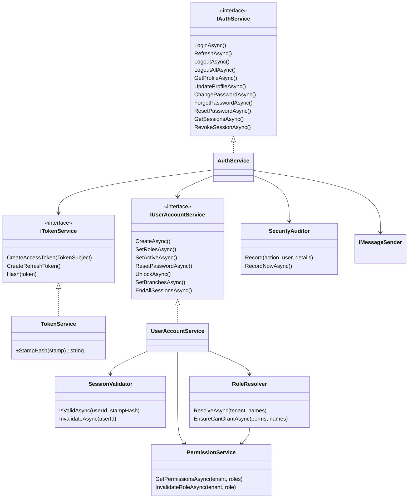

`ApplicationUser : IdentityUser<Guid>` is the **only** login table for every kind of user. The person
record points back to it: `Staff.UserId`, `Guardian.UserId`, `Student.UserId` (each unique).

### 7.2 Access token claims

| Claim | Value | Used by |
|---|---|---|
| `sub` | user id | everything |
| `jti` | random | uniqueness |
| `name`, `given_name`, `email` | profile | display, logs |
| `tenant_id` | tenant (absent for platform) | tenant filter, write guard |
| `user_type` | Staff / Guardian / Student / PlatformAdmin | portal rules |
| `role` (many) | role names | permission resolution |
| `branch_id` (many) | accessible branches | `EnsureBranchAccess` |
| `staff_id` / `guardian_id` / `student_id` | linked profile | "my" endpoints |
| `sstamp` | first 16 hex chars of SHA-256(security stamp) | instant revocation |
| `pwd_change` | `1` when a temporary password is in use | password gate |

`MapInboundClaims = false`, so names are exactly as issued. HS256, issuer/audience validated, 30 s skew.

### 7.3 Login

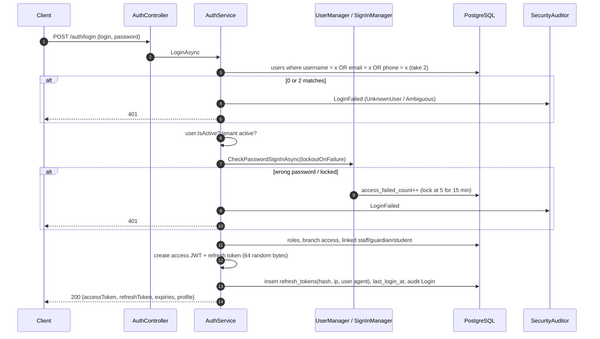

### 7.4 Refresh rotation and reuse detection

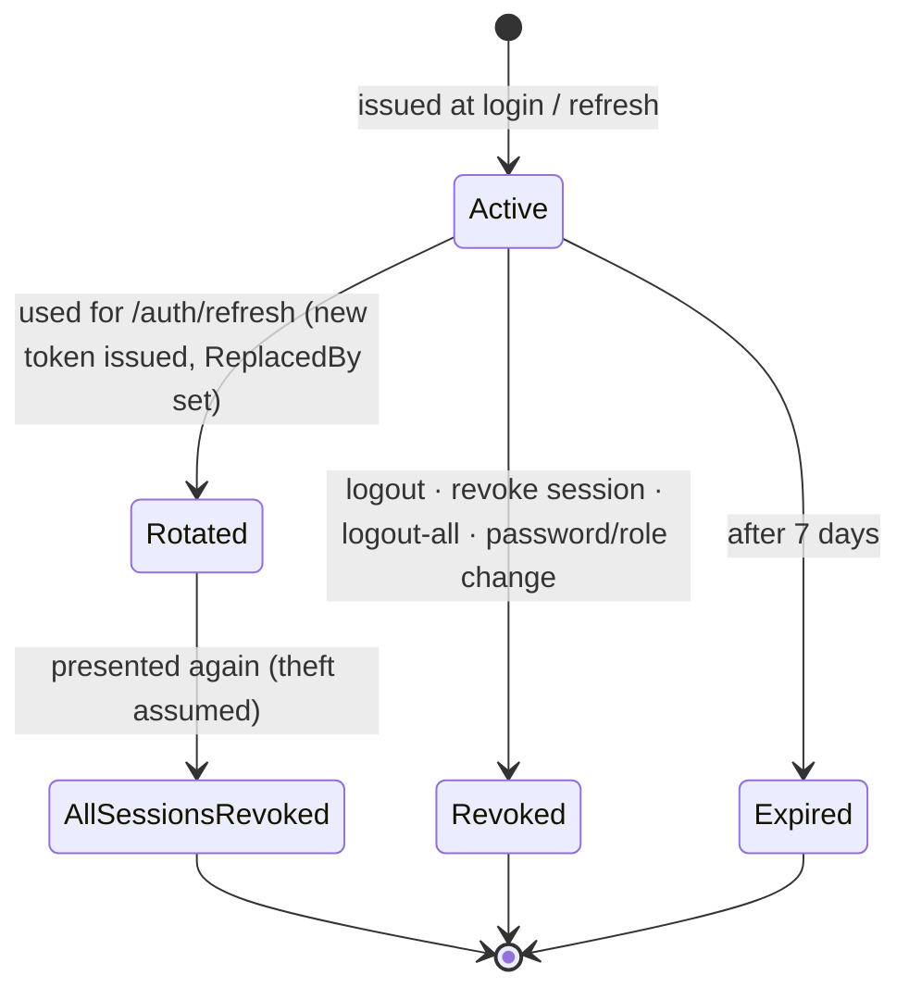

`EndAllSessionsAsync(userId)` = revoke every active refresh token **and** `UpdateSecurityStampAsync`
**and** remove `user-session:{id}` from cache → every outstanding access token fails on its next request.

### 7.5 Per-request session check

`SessionValidator.IsValidAsync(userId, sstamp)` reads `{IsActive, StampHash}` from cache
(`user-session:{id}`, 2 min) or the DB, and succeeds only if the user is active and the hash matches.
Any account change calls `InvalidateAsync`, so the 2-minute TTL is only an upper bound after a cache outage.

### 7.6 Forgot / reset password

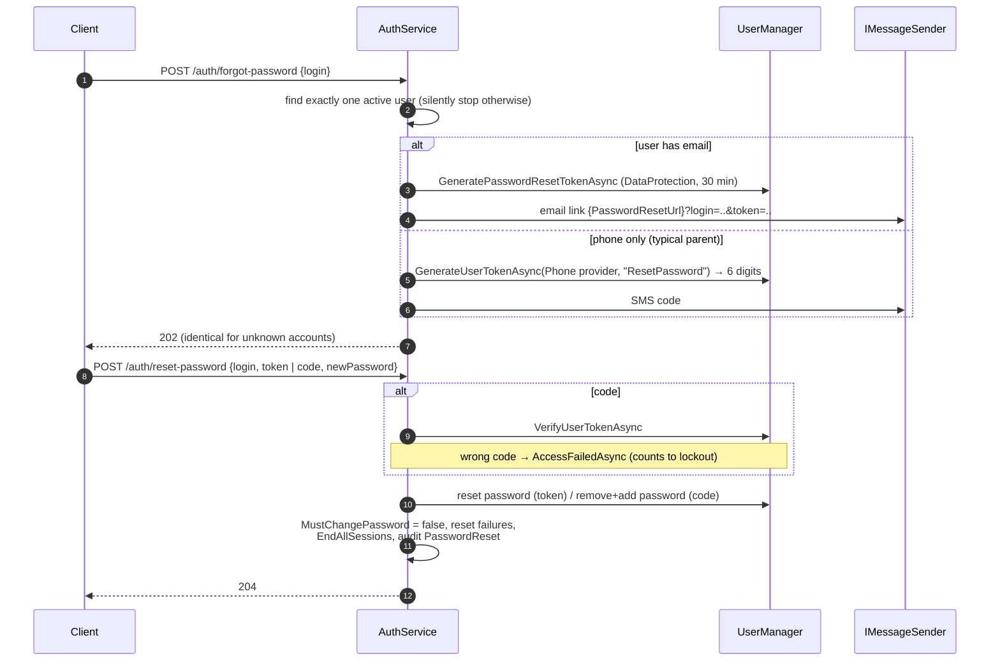

Data Protection keys are stored in PostgreSQL (`data_protection_keys`), so links stay valid across
restarts and multiple instances; the security stamp changes on reset, which makes every link single use.

### 7.7 Forced password change

Accounts created by an admin (staff, parent, student logins) and admin resets get a generated
temporary password (`GenerateTemporaryPassword`: 12 chars, 3 upper + 6 lower + 3 digits without look-alike characters, crypto RNG, shuffled) and
`MustChangePassword = true`. The token then carries `pwd_change=1` and
`PasswordChangeRequiredMiddleware` returns **403 `password_change_required`** for anything outside
`/api/v1/auth/*`. `change-password` clears the flag, ends other sessions and returns fresh tokens.

### 7.8 Account administration

| Operation | Side effects |
|---|---|
| Create login (staff / guardian / student) | user + role(s) + branch access + link `UserId` on the person; temp password returned once |
| Set roles | `RoleResolver` checks; cannot change own roles; new stamp; sessions ended; audit `RolesChanged` |
| Activate / deactivate | `is_active`; sessions ended on deactivate; audit |
| Unlock | lockout end cleared, failures reset; audit |
| Admin reset password | temp password, `MustChangePassword`, sessions ended |
| Set branches | `user_branch_access` replaced; stamp updated (claims change) |
| Logout everywhere | `EndAllSessionsAsync` |

---

## 8. Authorization

### 8.1 Model

```
Permission  "students.view", "fees.collect", ...   (~80, in Permissions.cs, grouped by module)
Role        named bundle of permissions, stored as role_claims(type = "permission")
            built-in (tenant_id null, is_system) or tenant-defined (tenant_id = X)
User        has roles (user_roles); a tenant role overrides a built-in role with the same name
```

Built-in roles (25) with default permissions live in `AppRoles.cs`. `DbInitializer` syncs them on
every start: adds missing roles, adds missing permissions and removes stale ones, so code is the source
of truth for built-ins.

### 8.2 Enforcement

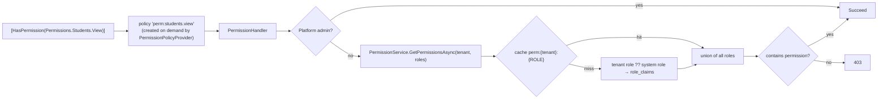

Endpoints without `[HasPermission]` still require authentication (fallback policy); public endpoints
use `[AllowAnonymous]` explicitly (login, refresh, logout, forgot-password, reset-password, health checks).

### 8.3 Data-level rules (inside services)

| Rule | Implementation |
|---|---|
| Tenant isolation | query filter + write guard (§6) |
| Branch isolation | `currentUser.EnsureBranchAccess(branchId)`; tenant-wide roles (TenantAdmin, Director) skip it |
| Ownership (portal) | parent: students linked via `student_guardians` to `guardian_id` claim; student: own `student_id` |
| Privilege escalation | `RoleResolver.EnsureCanGrantAsync`: SuperAdmin only by platform; platform permissions never inside a tenant; TenantAdmin/Director reserved for full-control users; caller must hold every permission granted |
| Self-protection | cannot change own roles, deactivate self, or admin-reset own password (use change password) |

---

## 9. Application services

### 9.1 Shape of a feature

```
Features/Students/
  StudentContracts.cs   records: StudentQuery, CreateStudentRequest, StudentListItemDto, StudentDetailDto
                        validators: CreateStudentRequestValidator : AbstractValidator<...>
                        interface IStudentService
  StudentService.cs     sealed class StudentService(IApplicationDbContext db, ICurrentUser user,
                        IDocumentNumberGenerator numbers, IValidator<...> validator, TimeProvider clock)
```

Services: validate → check access → load with `AsNoTracking` + projection for reads → mutate tracked
entities for writes → `SaveChangesAsync` → return a DTO / id. Entities never leave the service.

Paging: queries derive from `PagedRequest(Page, PageSize 1..200 default 20, Search)` → `ToPagedResultAsync` →
`PagedResult<T>(Items, Page, PageSize, TotalCount)` with `TotalPages` and `HasNext`.

### 9.2 Create student (admission)

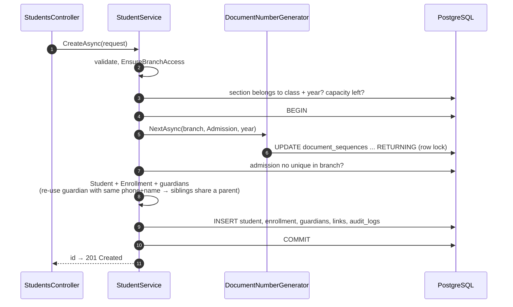

### 9.3 Create employee with login

Same transaction pattern: validate (PAN / IFSC / UAN formats, age ≥ 18, probation/confirmation after joining) →
reference checks (department, reporting manager in same branch) → duplicate identity check → `EMP`
number → `Staff` + qualifications + experiences → optional login via `UserAccountService.CreateAsync`
(roles checked by `RoleResolver`) → commit → returns employee code and the one-time temporary password.

Staff status lifecycle:

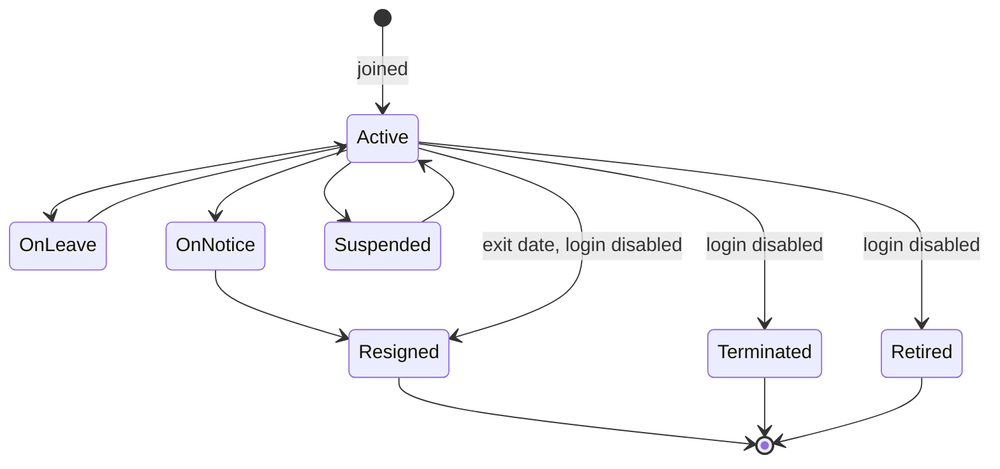

---

## 10. Document numbering

Goal: human-readable, per-branch, per-type (optionally per-year) numbers such as
`DPS-ADM/2026-27/00042`, with **no duplicates under concurrency** and **no gaps on rollback**.

Algorithm (`DocumentNumberGenerator.NextAsync`):

1. Load the branch code and the academic-year name.
2. `UPDATE document_sequences SET next_value = next_value + 1 WHERE (tenant, branch, type, year) RETURNING next_value - 1, prefix, format, padding`. The row lock serialises concurrent callers until the caller's transaction ends.
3. No row → `INSERT ... ON CONFLICT DO NOTHING` a default sequence (`{BRANCH}-{TYPE}`, format `{PREFIX}/{YEAR}/{SEQ}` or `{PREFIX}/{SEQ}`, padding 5) and retry once.
4. Format: replace `{PREFIX}`, `{YEAR}`, `{BRANCH}`, `{SEQ}` (zero-padded); collapse `//`.

Runs on the caller's connection and transaction, so a rollback returns the number.
Types: Admission, Enrollment, Invoice, Receipt, Refund, TransferCertificate, BonafideCertificate,
CharacterCertificate, HallTicket, StaffCode. Schools can change prefix / format / padding per row.

---

## 11. Caching

`ICacheService` (Application) → `DistributedCacheService` (Infrastructure, singleton):

| Method | Behaviour |
|---|---|
| `GetOrCreateAsync(key, factory, ttl)` | cache-aside; JSON (web defaults) |
| `SetAsync`, `GetAsync`, `RemoveAsync` | default TTL 30 min |
| Failure handling | any exception opens a **circuit for 30 s** (`Interlocked` ticks); during it every call is a no-op/miss; logged once as warning |

Keys are only built in `CacheKeys` (so invalidation is greppable). Redis instance prefix `bonzer:`.
Values cached are small and non-sensitive (permission names, active flag + stamp hash, master data).

---

## 12. Errors, validation and API conventions

### 12.1 Exception handling design

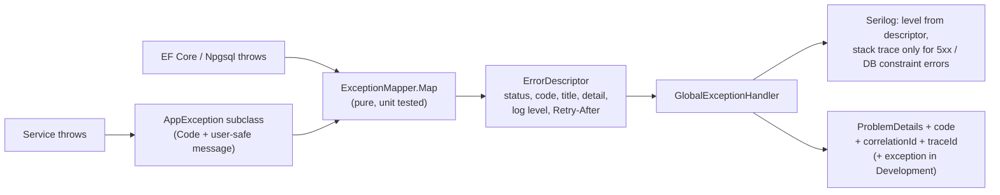

Rules

* Services throw **typed exceptions** (`Application/Common/Exceptions`); they never return error flags or
  catch-and-swallow. `catch` is used only to translate (provider error → `MessageDeliveryException`) or
  when a failure must not change the response (forgot-password delivery, see §7.6).
* Every `AppException` has a stable `Code` from `ErrorCodes` (never renamed; clients switch on it).
* The response never contains internals in Production. Development adds an `exception` object.
* Programming errors (`InvalidOperationException`, null refs) are 500 `internal_error`, logged with stack trace.
* One error format for everything, including responses that never threw: model-binding errors, empty
  401/403/404/405 (`UseStatusCodePages`), JWT challenges (`AuthenticationProblemWriter`) and 429s.

### 12.2 Exception → HTTP mapping (`ExceptionMapper`)

| Exception | Status | Code | Log level |
|---|---|---|---|
| `ValidationException` (FluentValidation) / invalid model or JSON | 400 + `errors{field: [..]}` | `validation_failed` | Information |
| `UnauthorizedException` | 401 | `invalid_credentials`, `account_locked`, `account_disabled`, `ambiguous_login`, `subscription_inactive`, `session_expired` | Information |
| JWT challenge | 401 + `WWW-Authenticate` | `unauthenticated`, `token_expired` (→ refresh), `token_invalid`, `session_revoked` (→ sign in) | Information |
| `ForbiddenAccessException` | 403 | `forbidden`, `cross_tenant_access`, `password_change_required` | Warning |
| `NotFoundException` / unknown route | 404 | `not_found` | Information |
| wrong HTTP method | 405 | `method_not_allowed` | Information |
| `ConflictException` | 409 | `conflict` | Information |
| `DbUpdateConcurrencyException` (stale `xmin`) | 409 | `concurrency_conflict` | Information |
| PostgreSQL 23505 unique | 409 | `duplicate_record` | Warning + exception |
| PostgreSQL 23503 foreign key | 409 | `record_in_use` | Warning + exception |
| PostgreSQL 23P01 exclusion | 409 | `conflict` | Information |
| PostgreSQL 23502 / 23514 / 22001 / 22003 / 22P02 | 422 | `constraint_violation` | Warning + exception |
| `BusinessRuleException` | 422 | `business_rule_violation`, `invalid_reset_token`, ... | Information |
| rate limiter | 429 + `Retry-After` | `rate_limited` | Warning |
| client disconnected (`OperationCanceledException` + aborted) | 499 (not sent) | `client_closed_request` | Information |
| PostgreSQL 40001 / 40P01 (serialization, deadlock) | 503 + `Retry-After: 1` | `transient_failure` | Warning + exception |
| PostgreSQL 57014, `TimeoutException` | 503 + `Retry-After: 5` | `timeout` | Error + exception |
| other transient Npgsql / PostgreSQL (failover, too many connections) | 503 + `Retry-After: 10` | `database_unavailable` | Error + exception |
| `ExternalServiceException` / `MessageDeliveryException` | 503 + `Retry-After: 30` | `service_unavailable`, `message_delivery_failed` | Error + exception |
| anything else | 500 | `internal_error` | Error + exception |

Body (RFC 7807):

```json
{
  "type": "https://tools.ietf.org/html/rfc9110#section-15.5.5",
  "title": "Not found",
  "status": 404,
  "detail": "Student '0190…' was not found.",
  "instance": "/api/v1/students/0190…",
  "code": "not_found",
  "correlationId": "web-7f3a9c2d41b0",
  "traceId": "4bf92f3577b34da6a3ce929d0e0e4736"
}
```

### 12.3 Validation

FluentValidation validators next to the request records, registered by assembly scan, called
explicitly by services (`ValidateAndThrowAsync`), so the same rules apply to API and future jobs.
Shared rules: `StrongPassword()` (≥ 8, upper, lower, digit), phone pattern, Aadhaar 12 digits, PAN `[A-Z]{5}[0-9]{4}[A-Z]`,
IFSC `[A-Z]{4}0[A-Z0-9]{6}`, bank account 6-20 digits, UAN 12 digits, employee age ≥ 18, joining ≤ 6 months ahead.

### 12.4 REST conventions

| Aspect | Convention |
|---|---|
| Base path | `/api/v1/<resource>` (kebab-case, plural) |
| Create | `POST` → 201 + `Location` + id |
| Update | `PUT /{id}` → 204 |
| Partial state changes | sub-resources: `PUT /{id}/status`, `PUT /{id}/roles`, `POST /{id}/unlock` |
| Delete | `DELETE /{id}` → 204 (soft) |
| List | `GET ?page=&pageSize=&search=` + filters → `PagedResult` |
| Ids | UUID strings |
| Enums | strings (`"Female"`, `"Teaching"`) |
| Dates | ISO 8601; `DateOnly` for dates of birth, attendance, joining |
| Time | UTC everywhere (`TimeProvider` injected for testability) |
| Versioning | URL segment `v1`; breaking changes → `v2` controllers side by side |

---

## 13. Logging and auditing

### 13.1 Logging stack

Serilog is the logging pipeline (structured events, not strings), configured from `appsettings.json`:

| Sink | Purpose | Notes |
|---|---|---|
| Console | containers / `docker logs` / local runs | template includes `CorrelationId` and `SourceContext` |
| File (wrapped in **Async**) | local evidence, shipping to ELK/Loki | compact JSON, daily, 30 files, 100 MB roll-over; the request thread never waits for disk |
| Seq | search, dashboards, alerts | `Serilog__WriteTo__2__Args__serverUrl` (+ `apiKey`) per environment |

Enrichers: `MachineName`, `EnvironmentName`, `Application`, `Version` (assembly informational version),
`CorrelationId`, `TenantId`, `UserId` (log context), W3C `TraceId`/`SpanId`, and **Serilog.Exceptions**
(exception properties such as `SqlState`, `ConstraintName`, inner exceptions as structured data; the EF
destructurer skips `DbUpdateException.Entries` so tracked entities and their PII are never dumped).

### 13.2 What is logged where

| What | Where | Fields |
|---|---|---|
| Request completion (one line per request) | `UseSerilogRequestLogging` | method, path, status (**final**, after exception mapping), elapsed, `ClientIp`, `UserAgent`, `TenantId`, `UserId`, `UserType`, `CorrelationId`, `ErrorCode`, `ExceptionType` |
| Request level | — | Error for 5xx, Warning above `RequestLogging:SlowRequestThresholdMs` (2 s), Verbose for `/health`, else Information |
| Handled failures | `GlobalExceptionHandler` | one event per failure, level from §12.2; stack trace only where it helps |
| Slow SQL | `SlowQueryInterceptor` | Warning above `Database:SlowQueryThresholdMs` (500 ms) with SQL text (no parameter values) |
| Rate limiting | `Bonzer.Api.RateLimiting` | Warning with client IP and path |
| Crashes outside requests | `AppDomain.UnhandledException`, `TaskScheduler.UnobservedTaskException` | Fatal / Error |
| Startup / shutdown | `Program` | version, environment, fatal startup errors (bootstrap logger) |
| Data audit | `audit_logs` (interceptor) | tenant, user, action, entity, id, old/new JSON, changed columns, IP, correlation id, timestamp |
| Security audit | `audit_logs` with `entity_name = 'User'` (`SecurityAuditor`) | `Login`, `LoginFailed`, `Logout`, `LogoutAll`, `PasswordChanged`, `PasswordResetRequested` (with `delivered`), `PasswordReset`, `RolesChanged`, `AccountStatusChanged`, `AccountUnlocked`, `TokenReuseDetected` |

ASP.NET's own "unhandled exception" log for handled exceptions is switched off
(`Microsoft.AspNetCore.Diagnostics.ExceptionHandlerMiddleware: Fatal`), so each failure is logged once.

### 13.3 Correlation

`CorrelationIdMiddleware` (first in the pipeline) takes `X-Correlation-Id` from the caller if it is short
and safe (≤ 64 chars, `[A-Za-z0-9-_.:]`, which also blocks log injection), otherwise the W3C trace id. It
becomes `HttpContext.TraceIdentifier`, so the **same id** appears in the response header, the error body,
every log event and `audit_logs.correlation_id`. Support asks the user for it and searches Seq with
`CorrelationId = 'web-7f3a9c2d41b0'`.

### 13.4 Rules

* Log with message templates and properties (`"Staff {StaffId} created"`), never string interpolation.
* Never log passwords, tokens, reset codes (outside Development), request bodies or decrypted `[Encrypted]` values.
* Error = someone must act; Warning = suspicious or degraded; Information = business events; Debug = development only.
* Suggested Seq alerts: any `@Level = 'Fatal'`; Error rate > 1 % of requests over 5 min; `ErrorCode = 'database_unavailable'`;
  `@MessageTemplate like 'Slow query%'` count spike; `TokenReuseDetected` security events.

## 14. Configuration reference

| Key | Default | Notes |
|---|---|---|
| `ConnectionStrings:Database` | — | required |
| `ConnectionStrings:Redis` | empty → in-memory | `host:6379,abortConnect=false` |
| `Jwt:Issuer` / `Audience` | `bonzer-erp` / `bonzer-erp-clients` | required |
| `Jwt:SigningKey` | — | required, ≥ 32 chars, secret |
| `Jwt:AccessTokenMinutes` / `RefreshTokenDays` | 15 / 7 | |
| `Encryption:Key` | — | required, base64 32 bytes, secret, back it up |
| `Database:MigrateOnStartup` | false (true in Development) | production: run migrations as a release step |
| `Seed:SuperAdmin:Email/Password`, `Seed:DemoData` | — | first deployment / development |
| `RateLimiting:AuthPermitLimit` | 10 per minute per IP | |
| `Messaging:PasswordResetUrl` | — | front-end page that receives `login` and `token` |
| `Database:SlowQueryThresholdMs` | 500 | slow SQL warning |
| `RequestLogging:SlowRequestThresholdMs` | 2000 | slow request warning |
| `Messaging:Smtp:Host/Port/UserName/Password/From/EnableSsl` | empty → log only | |
| `Cors:AllowedOrigins` | [] | |
| `Serilog:*` | see appsettings.json | sinks, levels |

Environment variables use `__` (e.g. `Jwt__SigningKey`).

---

## 15. Design patterns used

| Pattern | Where | Why |
|---|---|---|
| Clean / Onion Architecture | four projects | testability, replaceable infrastructure |
| Dependency Inversion | `IApplicationDbContext`, `ICacheService`, `IMessageSender`, `ICurrentUser` | Application knows only abstractions |
| Unit of Work + Repository | EF Core `DbContext` / `DbSet` | no extra generic repository layer (ADR-10) |
| Service layer (use-case services) | `Features/*/…Service` | one place per business operation |
| DTO / Request-Response records | `*Contracts.cs` | entities never leak to the API |
| Interceptor (AOP) | `AuditableEntityInterceptor`, `AuditTrailInterceptor` | cross-cutting concerns on every save |
| Specification via expression trees | global query filters | isolation can't be forgotten |
| Convention over configuration | `ApplyErpConventions` | rules once, not per entity |
| Template / layered supertype | `BaseEntity → … → BranchEntity` | shared columns and behaviour |
| Value Object | `Address`, `BankDetails`, … (owned types) | grouped fields, compared by value |
| Strategy | `IMessageSender` (SMTP / log / future SMS), `IFieldEncryptor` | swap providers by configuration |
| Policy provider (factory) | `PermissionPolicyProvider` | policies created on demand from attribute names |
| Chain of responsibility | ASP.NET middleware pipeline | each concern in its own middleware |
| Cache-aside + Circuit breaker | `DistributedCacheService` | fast, and survives Redis outages |
| Exception translation / mapper | `ExceptionMapper`, `MessageDeliveryException` | one tested place turns failures into stable codes |
| Correlation identifier | `CorrelationIdMiddleware` | one id across client, logs and audit |
| Token rotation with reuse detection | refresh tokens | detects stolen tokens |
| Options pattern with validation | `JwtOptions`, `EncryptionOptions`, `MessagingOptions` | typed, fail-fast config |
| Soft delete | `ISoftDeletable` + interceptor | history and recovery |
| Optimistic concurrency | `xmin` row version | no lost updates without locks |
| Pessimistic row lock | document sequences | gap-free numbering |
| Seeder / idempotent sync | `DbInitializer` | roles converge to code on every deploy |
| Planned: Transactional outbox, Saga for payments, CQRS read models for reports | §16 | reliability and scale |

SOLID in practice: one class per responsibility (TokenService ≠ AuthService ≠ SessionValidator);
open for extension through interfaces and conventions; services depend on abstractions.

---

## 16. Planned module designs

### 16.1 Attendance marking

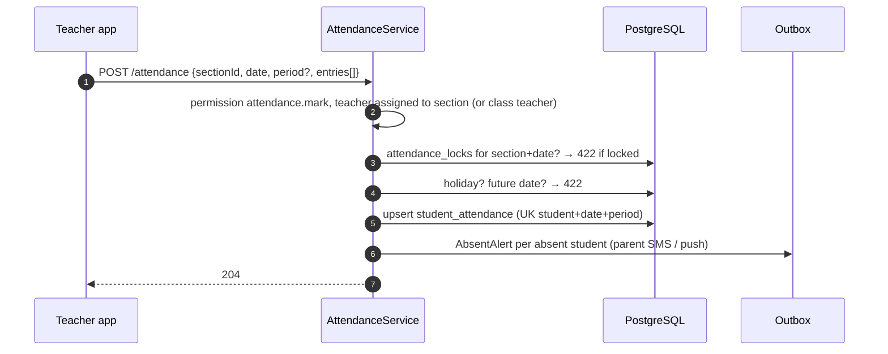

Corrections after lock go through `attendance_correction_requests` (approve → update + audit).
Monthly partitioning of `student_attendance` by `attendance_date`.

### 16.2 Fee invoicing and collection

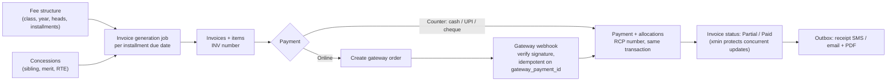

Rules: allocation oldest-due first unless chosen; overpayment → advance credit; refunds as a separate
document (`RFD`); cancelled receipts are never deleted, only reversed.

### 16.3 Exams and results

Marks entry per component (`marks` with `xmin` for concurrent teachers) → lock exam →
`ResultCalculator`: sum components → apply grading scheme bands → subject pass/fail → total,
percentage / GPA → rank within section → `student_results` → report card PDF job → publish (parents
notified). Re-calculation is idempotent (results overwritten from marks).

### 16.4 Notifications (transactional outbox)

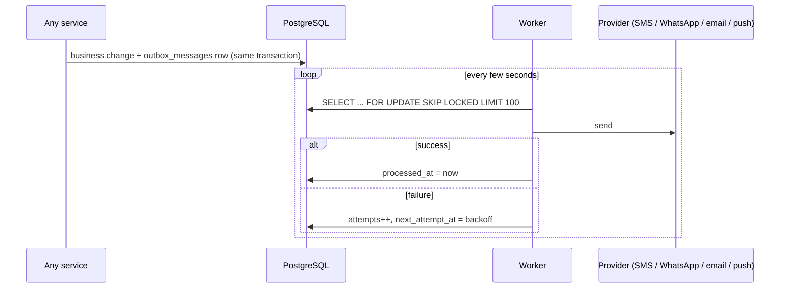

`SKIP LOCKED` lets several workers run safely; dead letters after N attempts are visible to admins.

### 16.5 Year-end promotion

Wizard per class: for each active enrollment choose Promote (to `ClassLevel.NextClassLevelId`),
Detain or Graduate → new `student_enrollments` in the next academic year (old one closed) in one
transaction per section; dry-run mode returns the plan first.

### 16.6 Reporting (CQRS-lite)

Dashboards read from SQL views / materialised views on the read replica (attendance %, fee collection
by day and head, class strength), refreshed by jobs. Writes stay on the primary through the services.

---

## 17. Testing strategy

| Level | Tooling | What | Status |
|---|---|---|---|
| Unit | xUnit | model building (filters, keys, encryption), validators, token helpers, temp password, masking, exception mapping, correlation ids | **Built** (64 tests) |
| Integration | xUnit + Testcontainers (PostgreSQL, Redis) | interceptors, tenant isolation, numbering under concurrency, migrations | Planned |
| API / E2E | scripted HTTP flows | login → forced change → reset (email + SMS) → sessions → role change → lockout → security rules | Run manually (19 checks pass) |
| Security | OWASP ZAP baseline, dependency scanning | headers, injection, vulnerable packages | Planned in CI |
| Load | k6 | 9 AM attendance burst, results day | Planned |

Must-have tests for every new module: tenant A cannot read or write tenant B; branch user cannot touch
another branch; every endpoint has the intended permission.

---

## 18. How to add a module

1. **Domain**: entities in `Entities/<Module>/`, derive from `BranchEntity` or `TenantEntity`; enums in `Enums/`.
2. **Persistence**: `Configurations/<Module>/` (lengths, indexes with `HasFilter(Sql.NotDeleted)`); add `DbSet` to `BonzerDbContext` and `IApplicationDbContext`.
3. **Migration**: `dotnet ef migrations add <Module>` and review the SQL.
4. **Permissions**: add to `Permissions.cs` and to role defaults in `AppRoles.cs` (synced on start).
5. **Application**: `Features/<Module>/<Module>Contracts.cs` + `<Module>Service.cs`; register in `DependencyInjection.cs`.
6. **API**: `Controllers/<Module>Controller.cs` deriving from `ApiControllerBase`, each action with `[HasPermission]`.
7. **Cache**: new keys only in `CacheKeys`, invalidate on write.
8. **Tests**: validators + isolation tests; update this LLD (ER diagram + flows) in the same PR.
